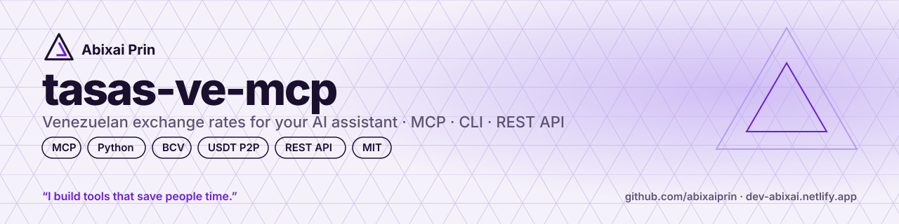
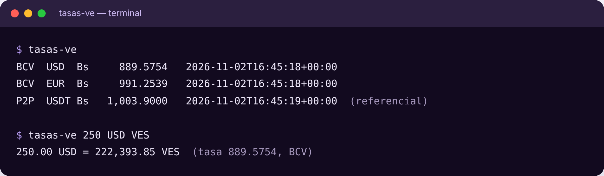

<p align="center"></p>

# tasas-ve-mcp

**Las tasas de Venezuela para tu asistente de IA, en una línea.**
Tasa oficial del BCV (USD, EUR), **la tasa de compra y venta de cada banco venezolano** y la referencia de mercado USDT P2P, como servidor MCP, comando de terminal y librería de Python.

[English](README.md) · [Español](README.es.md)

> **Tú:** ¿Cuánto son 250 dólares en bolívares hoy?
> **Claude:** A la tasa oficial del BCV (Bs 889,58 por USD, 2 nov. 2026), USD 250 = **Bs 222.393,85**. La referencia USDT P2P está en Bs 1.003,90, una brecha de 12,85 %.

<p align="center"></p>


> 🧩 **También disponible como skill para agentes en [Agensi](https://www.agensi.io/skills/tasas-ve-venezuela-exchange-rates-bcv-banks-p2p)**: instálala en Claude Code, Cursor y más de 20 agentes. [Mira todas mis skills](https://www.agensi.io/creators/abixai-prin).

## Por qué
- **Tu asistente deja de adivinar.** Los modelos no saben la tasa de hoy; esto le da el número real, con fuente y fecha.
- **Rápido y barato.** Una sola llamada pequeña y el cálculo se hace en local: casi no gasta tokens.
- **Sigue funcionando si la fuente se cae.** Guarda el último valor en disco y lo devuelve con un aviso.

## Empezar

Necesitas [uv](https://docs.astral.sh/uv/) (o `pip install git+https://github.com/abixaiprin/tasas-ve-mcp`).

**VS Code** — `.vscode/mcp.json`
```json
{ "servers": { "tasas-ve": { "command": "uvx", "args": ["--from", "git+https://github.com/abixaiprin/tasas-ve-mcp", "tasas-ve-mcp"] } } }
```

**Claude Desktop / Cursor**
```json
{ "mcpServers": { "tasas-ve": { "command": "uvx", "args": ["--from", "git+https://github.com/abixaiprin/tasas-ve-mcp", "tasas-ve-mcp"] } } }
```

**Terminal**
```bash
uvx --from git+https://github.com/abixaiprin/tasas-ve-mcp tasas-ve
uvx --from git+https://github.com/abixaiprin/tasas-ve-mcp tasas-ve 100 USD VES
uvx --from git+https://github.com/abixaiprin/tasas-ve-mcp tasas-ve --bancos   # tasa por banco
uvx --from git+https://github.com/abixaiprin/tasas-ve-mcp tasas-ve 5000 VES USD --p2p
```

## Úsalo desde cualquier app (React, Vue, Java, PHP…)
Ejecútalo como un pequeño servicio web y llámalo por HTTP. También ofrece **MCP remoto** en `/mcp`.
```bash
uvx --from git+https://github.com/abixaiprin/tasas-ve-mcp tasas-ve-mcp --http --port 8000
```
| Endpoint | Ejemplo |
|---|---|
| `GET /api/tasas` | Tasas BCV y P2P |
| `GET /api/bancos` | Compra y venta por banco + promedio |
| `GET /api/convertir` | `/api/convertir?monto=100&de=USD&a=VES&fuente=bcv` |
| `GET /salud` | Estado del servicio |

```js
// React, Vue o cualquier JavaScript
const r = await fetch("https://TU-SERVICIO/api/convertir?monto=100&de=USD&a=VES");
const { resultado, tasa_usada } = await r.json();
```
**Despliegue gratis:** el repo trae `render.yaml`. En [Render](https://render.com) elige *New → Blueprint* y selecciona este repo.

## Herramientas
| Herramienta | Qué hace |
|---|---|
| `tasa_bcv` | Tasa oficial del BCV: Bs por 1 USD y 1 EUR |
| `tasas_bancos` | Compra y venta (Bs/USD) que reporta cada banco al BCV: Mercantil, Banesco, BNC, Provincial, BanCaribe… y el promedio |
| `tasa_p2p` | Referencia USDT/VES (mediana de anuncios P2P, venta o compra) |
| `convertir` | Convierte entre VES, USD, EUR y USDT con `bcv` o `p2p` |
| `brecha_cambiaria` | Diferencia (%) entre la tasa oficial y la referencia P2P |

## Para equipos y empresas
- **Una sola fuente para la tasa.** Tus apps, hojas de cálculo y asistentes de IA leen el mismo número, con fuente y fecha. Se acabó copiarlo a mano cada mañana.
- **Se conecta con lo que ya usas:** Claude, Cursor o VS Code por MCP; React, Vue, Java o PHP por la API REST.
- **Lo alojas tú y es auditable.** Es código abierto, solo lee páginas públicas y no envía datos de tu empresa.
- **No se cae contigo.** Si la fuente falla, tus sistemas siguen con el último valor conocido.

## Fuentes y aviso
- **BCV y bancos:** página pública `bcv.org.ve` (tasa oficial y *Tasas Informativas del Sistema Bancario*). Si su certificado TLS no se puede verificar, la respuesta lo indica.
- **P2P:** listado público de anuncios P2P de Binance. Es una **referencia de mercado, no una tasa oficial**. Sin afiliación con el BCV ni con Binance.
- Las tasas son informativas. Verifica la fuente oficial antes de usarlas con fines legales o contables.

## ¿Lo necesitas para tu empresa?
Adapto herramientas como esta a tu negocio: integración con tus sistemas, pagos, asistentes con IA y soporte.
→ [dev-abixai.netlify.app](https://dev-abixai.netlify.app) · dev.abixai.martinez@gmail.com

## Apoya el proyecto
- ⭐ **Dale una estrella** al repo: ayuda a que otros lo encuentren.
- ☕ **[Invítame un café en Ko-fi](https://ko-fi.com/abixaiprin)** para que sigan saliendo herramientas.
- 🔁 Compártelo con un equipo que todavía copia la tasa a mano.

## Licencia
MIT © 2026 [Abixai Prin](https://dev-abixai.netlify.app). Puedes usarlo, modificarlo y compartirlo manteniendo el aviso de derechos de autor.

---
<p align="center"><sub>Hecho en Caracas por <b>Abixai Prin</b> · <i>I build tools that save people time.</i></sub></p>
