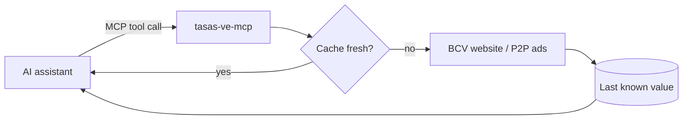

# tasas-ve-mcp

**Venezuelan exchange rates for your AI assistant, in one line.**
Official BCV rate (USD, EUR) and the USDT P2P market reference, as an MCP server, a CLI and a Python library.

  

[English](README.md) · [Español](README.es.md)

> *Example conversation (illustrative figures):*
>
> **You:** How much is 250 dollars in bolívares today?
> **Claude:** At today's BCV official rate (Bs 36.59 per USD, 2 Nov 2026), USD 250 = **Bs 9,146.85**. The USDT P2P reference is Bs 50.20, a 37 % gap.

## Why
- **Your assistant stops guessing.** LLMs don't know today's rate; this gives it the real number with source and timestamp.
- **Fast and cheap.** One small tool call, maths done locally — no long prompts, no scraping by the model, minimal tokens.
- **Keeps working when the source is down.** The last known value is cached on disk and returned with a warning.

## Quick start

Requires [uv](https://docs.astral.sh/uv/) (or use `pip install tasas-ve-mcp`).

**VS Code** — `.vscode/mcp.json`
```json
{ "servers": { "tasas-ve": { "command": "uvx", "args": ["tasas-ve-mcp"] } } }
```

**Claude Desktop / Cursor** — MCP config
```json
{ "mcpServers": { "tasas-ve": { "command": "uvx", "args": ["tasas-ve-mcp"] } } }
```

**Terminal**
```bash
uvx --from tasas-ve-mcp tasas-ve            # BCV + P2P rates
uvx --from tasas-ve-mcp tasas-ve 100 USD VES
uvx --from tasas-ve-mcp tasas-ve 5000 VES USD --p2p
```

**Python**
```python
from tasas_ve import Servicio
s = Servicio()
s.convertir(100, "USD", "VES")      # {'resultado': 3658.74, 'tasa_usada': 36.5874, ...}
```

## Tools
| Tool | What it does |
|---|---|
| `tasa_bcv` | Official BCV rate: Bs per 1 USD and 1 EUR |
| `tasa_p2p` | USDT/VES market reference (median of P2P ads, `SELL` or `BUY`) |
| `convertir` | Converts between VES, USD, EUR and USDT using `bcv` or `p2p` |
| `brecha_cambiaria` | Gap (%) between the official rate and the P2P reference |

## Cost & performance
| | |
|---|---|
| Tokens per question | one tool call + a ~200-byte JSON answer |
| Cache | BCV 30 min · P2P 3 min · last value saved to `~/.cache/tasas-ve/` |
| Network | Only public pages; nothing is sent about you |

## How it works


## Data sources and disclaimer
- **BCV:** public website `bcv.org.ve`. If its TLS certificate can't be verified, the answer says so.
- **P2P:** public Binance P2P ad listing. It is a **market reference, not an official rate**. Not affiliated with BCV or Binance.
- Rates are informative. Check the official source before any legal or accounting use.

## Roadmap
- [ ] Rate history and daily average
- [ ] More sources (other P2P platforms, parallel references)
- [ ] REST API and a widget for websites
- [ ] Other countries

Ideas? Open a [discussion](https://github.com/abixaiprin/tasas-ve-mcp/discussions).

## Contributing
```bash
git clone https://github.com/abixaiprin/tasas-ve-mcp && cd tasas-ve-mcp
pip install -e ".[dev]" && pytest
```

## Need this for your business?
I adapt tools like this to your company: integrations with your systems, payment flows, AI assistants and support.
→ [dev-abixai.netlify.app](https://dev-abixai.netlify.app) · dev.abixai.martinez@gmail.com

## Support
⭐ **Star the repo** if it saved you time — it helps others find it.

## License
MIT © 2026 Abixai Prin
