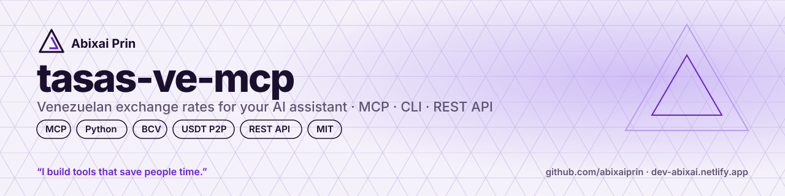
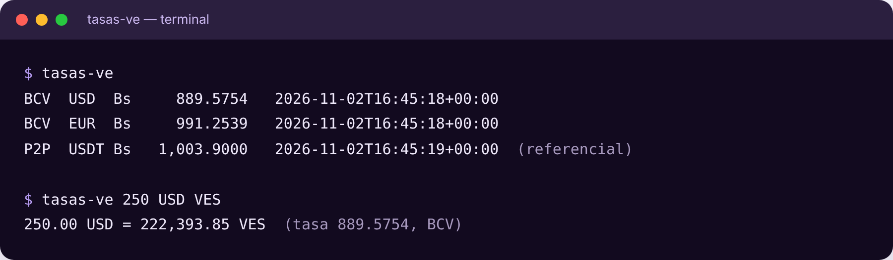
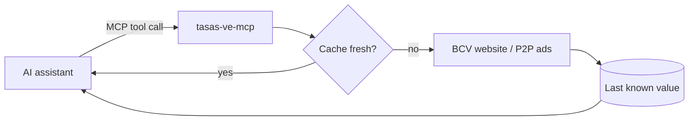

<p align="center"></p>

# tasas-ve-mcp

**Venezuelan exchange rates for your AI assistant, in one line.**
Official BCV rate (USD, EUR), **the buy/sell rate reported by each Venezuelan bank** and the USDT P2P market reference, as an MCP server, a CLI and a Python library.

  

[English](README.md) · [Español](README.es.md)

> **You:** How much is 250 dollars in bolívares today?
> **Claude:** At the BCV official rate (Bs 889.58 per USD, 2 Nov 2026), USD 250 = **Bs 222,393.85**. The USDT P2P reference is Bs 1,003.90, a 12.85 % gap.

<p align="center"></p>


> 🧩 **Also available as an agent skill on [Agensi](https://www.agensi.io/skills/tasas-ve-venezuela-exchange-rates-bcv-banks-p2p)**: install it in Claude Code, Cursor and 20+ agents. [See all my skills](https://www.agensi.io/creators/abixai-prin).

## Why
- **Your assistant stops guessing.** LLMs don't know today's rate; this gives it the real number with source and timestamp.
- **Fast and cheap.** One small tool call, maths done locally — no long prompts, no scraping by the model, minimal tokens.
- **Keeps working when the source is down.** The last known value is cached on disk and returned with a warning.

## Quick start

Requires [uv](https://docs.astral.sh/uv/) (or `pip install git+https://github.com/abixaiprin/tasas-ve-mcp`).

**VS Code** — `.vscode/mcp.json`
```json
{ "servers": { "tasas-ve": { "command": "uvx", "args": ["--from", "git+https://github.com/abixaiprin/tasas-ve-mcp", "tasas-ve-mcp"] } } }
```

**Claude Desktop / Cursor** — MCP config
```json
{ "mcpServers": { "tasas-ve": { "command": "uvx", "args": ["--from", "git+https://github.com/abixaiprin/tasas-ve-mcp", "tasas-ve-mcp"] } } }
```

**Terminal**
```bash
uvx --from git+https://github.com/abixaiprin/tasas-ve-mcp tasas-ve            # BCV + P2P rates
uvx --from git+https://github.com/abixaiprin/tasas-ve-mcp tasas-ve 100 USD VES
uvx --from git+https://github.com/abixaiprin/tasas-ve-mcp tasas-ve --bancos   # rate per bank
uvx --from git+https://github.com/abixaiprin/tasas-ve-mcp tasas-ve 5000 VES USD --p2p
```

**Python**
```python
from tasas_ve import Servicio
s = Servicio()
s.convertir(100, "USD", "VES")      # {'resultado': 88957.54, 'tasa_usada': 889.5754, ...}
```

## Use it from any app (React, Vue, Java, PHP…)
Run it as a small web service and call it over HTTP. It also exposes **remote MCP** at `/mcp`.
```bash
uvx --from git+https://github.com/abixaiprin/tasas-ve-mcp tasas-ve-mcp --http --port 8000
```
| Endpoint | Example |
|---|---|
| `GET /api/tasas` | BCV + P2P rates |
| `GET /api/bancos` | Buy/sell per bank + average |
| `GET /api/convertir` | `/api/convertir?monto=100&de=USD&a=VES&fuente=bcv` |
| `GET /salud` | health check |

**React / Vue / any JS**
```js
const r = await fetch("https://YOUR-SERVICE/api/convertir?monto=100&de=USD&a=VES");
const { resultado, tasa_usada } = await r.json();
```
**Java**
```java
var res = HttpClient.newHttpClient().send(
  HttpRequest.newBuilder(URI.create("https://YOUR-SERVICE/api/tasas")).build(),
  HttpResponse.BodyHandlers.ofString());
```
**Deploy for free:** the repo includes `render.yaml` — on [Render](https://render.com) choose *New → Blueprint* and pick this repo.

## Tools
| Tool | What it does |
|---|---|
| `tasa_bcv` | Official BCV rate: Bs per 1 USD and 1 EUR |
| `tasas_bancos` | Buy and sell rate (Bs/USD) reported by each bank to the BCV — Mercantil, Banesco, BNC, Provincial, BanCaribe… — plus the average |
| `tasa_p2p` | USDT/VES market reference (median of P2P ads, `SELL` or `BUY`) |
| `convertir` | Converts between VES, USD, EUR and USDT using `bcv` or `p2p` |
| `brecha_cambiaria` | Gap (%) between the official rate and the P2P reference |

## For teams and companies
- **One source of truth for the rate.** Your apps, spreadsheets and AI assistants read the same number, with source and timestamp — no more copying it by hand every morning.
- **Plug it into what you already use:** Claude, Cursor or VS Code via MCP; React, Vue, Java or PHP via the REST API.
- **Self-hosted and auditable.** It's open source, it only reads public pages and it sends no data about your company.
- **Resilient.** If the source goes down, your systems keep the last known value instead of breaking.

## Cost & performance
| | |
|---|---|
| Tokens per question | one tool call + a ~200-byte JSON answer |
| Cache | BCV 30 min · P2P 3 min · last value saved to `~/.cache/tasas-ve/` |
| Network | Only public pages; nothing is sent about you |

## How it works


## Data sources and disclaimer
- **BCV and banks:** public website `bcv.org.ve` (official rate and *Tasas Informativas del Sistema Bancario*). If its TLS certificate can't be verified, the answer says so.
- **P2P:** public Binance P2P ad listing. It is a **market reference, not an official rate**. Not affiliated with BCV or Binance.
- Rates are informative. Check the official source before any legal or accounting use.

## Roadmap
- [ ] Rate history and daily average
- [ ] More sources (other P2P platforms, parallel references)
- [ ] REST API and a widget for websites
- [ ] Other countries

Ideas? Open a [discussion](https://github.com/abixaiprin/tasas-ve-mcp/discussions).

## Contributing
```bash
git clone https://github.com/abixaiprin/tasas-ve-mcp && cd tasas-ve-mcp
pip install -e ".[dev]" && pytest
```

## Need this for your business?
I adapt tools like this to your company: integrations with your systems, payment flows, AI assistants and support.
→ [dev-abixai.netlify.app](https://dev-abixai.netlify.app) · dev.abixai.martinez@gmail.com

## Support
If this saved you time:
- ⭐ **Star the repo** — it helps other developers find it.
- ☕ **[Buy me a coffee on Ko-fi](https://ko-fi.com/abixaiprin)** — keeps new tools coming.
- 🔁 Share it with a team that still copies the rate by hand.

## License
MIT © 2026 [Abixai Prin](https://dev-abixai.netlify.app). You can use, modify and share it; keep the copyright notice.

---
<p align="center"><sub>Made in Caracas by <b>Abixai Prin</b> · <i>I build tools that save people time.</i></sub></p>
